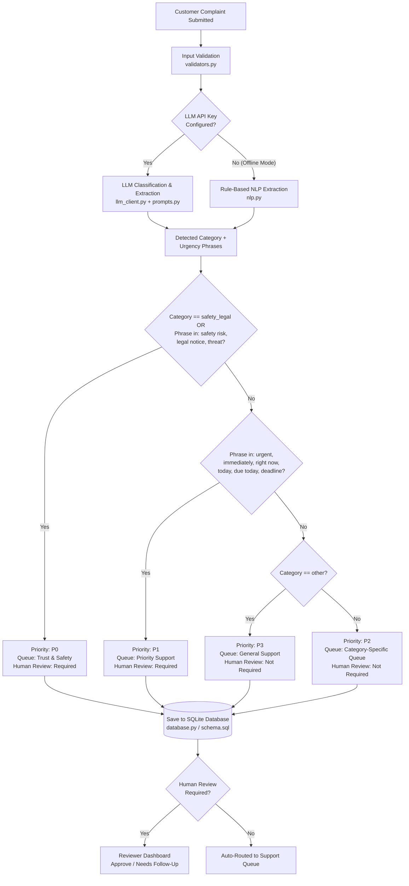

# Project 033 – Customer Complaint Triage & Escalation Assistant

A Streamlit application that accepts a complaint, performs lightweight NLP, applies deterministic escalation rules, optionally calls a real LLM API for a neutral summary, and stores cases and review history in SQLite.

## Features
- Complaint input validation
- Complaint category, course/product phrase, sentiment and urgency detection
- Deterministic P0–P3 escalation rules
- Optional real OpenAI or Anthropic API integration
- Strict JSON response validation
- SQLite records for customers, complaints, messages, cases and triage logs
- Human review status and notes
- Offline/rules-only mode when no API key is configured

## Important safeguards
- Use synthetic, anonymized, or trainer-approved data only.
- Do not put API keys in source code or commit `.env`.
- This is a demonstration assistant, not an autonomous customer-service system.
- It does not issue refunds/certificates, grade learners, send messages, or write to production CRM/LMS systems.
- The LLM summary is advisory. Deterministic rules control priority and human-review requirements.

## 1. Open in VS Code (Windows)
1. Download and extract the ZIP file.
2. Open VS Code.
3. Select **File → Open Folder** and choose `project_033_customer_complaint_triage`.
4. Open **Terminal → New Terminal**.
5. Confirm the terminal is in the project folder.

Check Python:
```powershell
py --version
```
Python 3.11 or 3.12 is recommended for this project.

## 2. Create and activate a virtual environment
```powershell
py -3.11 -m venv .venv
```
PowerShell:
```powershell
.\.venv\Scripts\Activate.ps1
```
If PowerShell blocks activation, use Command Prompt:
```cmd
.venv\Scripts\activate.bat
```
Or run the environment's Python directly without activation:
```powershell
.\.venv\Scripts\python.exe -m pip install -r requirements.txt
```

## 3. Install packages
```powershell
python -m pip install --upgrade pip
python -m pip install -r requirements.txt
```
Make sure the file is named exactly `requirements.txt` (not `requirement.txt` or `requirements.text`).

## 4. Configure the LLM (optional)
Copy `.env.example` to a new file named `.env`.
- For offline mode, leave `LLM_PROVIDER=none`.
- For OpenAI, set `LLM_PROVIDER=openai`, add your `OPENAI_API_KEY`, and choose a model available to your account.
- For Anthropic, set `LLM_PROVIDER=anthropic`, add your `ANTHROPIC_API_KEY`, and choose a model available to your account.

Never upload `.env` to GitHub. The `.gitignore` file excludes it. API calls may incur provider charges.

## 5. Run the app
```powershell
python -m streamlit run app.py
```
The browser should open the local Streamlit application. If it does not, use the local URL printed in the terminal.

The SQLite database is created automatically at `data/complaints.db`.

## 6. Run tests
```powershell
python -m pytest -q
```
Tests use a fake LLM client and do not require a paid API key. Record the actual test output in your project evidence; do not claim tests passed until you run them.

## 7. Upload to GitHub
1. Create a new empty repository on GitHub, for example `project-033-customer-complaint-triage`.
2. In VS Code, open the project folder.
3. Open **Source Control** from the left sidebar.
4. Select **Initialize Repository** if Git is not initialized.
5. Review the changed files. Confirm `.env` and `data/complaints.db` are not included.
6. Enter a commit message such as `Initial Project 033 application`.
7. Select **Commit**.
8. Select **Publish Branch** / **Publish to GitHub**, then choose the repository you created.
9. Refresh the GitHub repository page and verify the source files and README are present.

Alternative terminal commands (after creating an empty GitHub repository):
```powershell
git init
git add .
git status
git commit -m "Initial Project 033 application"
git branch -M main
git remote add origin https://github.com/YOUR-USERNAME/project-033-customer-complaint-triage.git
git push -u origin main
```
Replace `YOUR-USERNAME` with your GitHub username. Do not run `git add .` until you have checked that `.env` and local database files are ignored.

## 8. Deploy with Streamlit Community Cloud
1. Push the project to GitHub.
2. Sign in to Streamlit Community Cloud using your GitHub account.
3. Choose **Create app** / **New app**.
4. Select your repository, branch `main`, and main file path `app.py`.
5. In the app's **Settings → Secrets**, add secrets only if using an LLM provider. Example:
```toml
LLM_PROVIDER = "openai"
OPENAI_API_KEY = "paste-your-key-in-the-secret-manager"
OPENAI_MODEL = "gpt-4.1-mini"
DATABASE_PATH = "data/complaints.db"
MAX_COMPLAINT_CHARS = "5000"
```
For Anthropic, use `LLM_PROVIDER`, `ANTHROPIC_API_KEY`, and `ANTHROPIC_MODEL` instead.
6. Deploy and wait for the build to finish.
7. Open the public app URL and test with synthetic sample complaints.

**Deployment note:** Streamlit Community Cloud local filesystem storage may be ephemeral. A SQLite database on the hosted app is suitable for a demo, not durable production storage. Do not enter real customer data. For persistent production storage, use an approved managed database and security review. Keep the app private or access-controlled if the platform/account supports it.

## Sample test complaint
> I paid for the Data Analytics course, but I cannot log in and my assessment is due today. This is urgent.

Expected baseline:
- Category: `course_access`
- Urgency phrases: `today`, `due today`, `urgent` (depending on phrase matching)
- Priority: `P1`
- Queue: `Priority Support`
- Human review: required

## Troubleshooting
- `No module named streamlit`: activate `.venv` and run `python -m pip install -r requirements.txt`.
- `Could not open requirements.txt`: check the terminal folder and exact spelling.
- `streamlit is not recognized`: use `python -m streamlit run app.py`.
- PowerShell activation blocked: use Command Prompt activation or call `.venv\\Scripts\\python.exe` directly.
- API error: check provider, key, model access, billing/credits, network, and secrets. The app can still run in rules-only mode.

## Project structure
```text
project_033_customer_complaint_triage/
├── app.py
├── config.py
├── models.py
├── validators.py
├── nlp.py
├── rules.py
├── prompts.py
├── llm_client.py
├── database.py
├── workflow.py
├── schema.sql
├── requirements.txt
├── .env.example
├── .gitignore
├── runtime.txt
├── README.md
├── data/
│   └── .gitkeep
└── tests/
    ├── conftest.py
    ├── test_validators.py
    ├── test_nlp.py
    ├── test_rules.py
    └── test_workflow.py
```
## System Architecture & Triage Decision Flow


